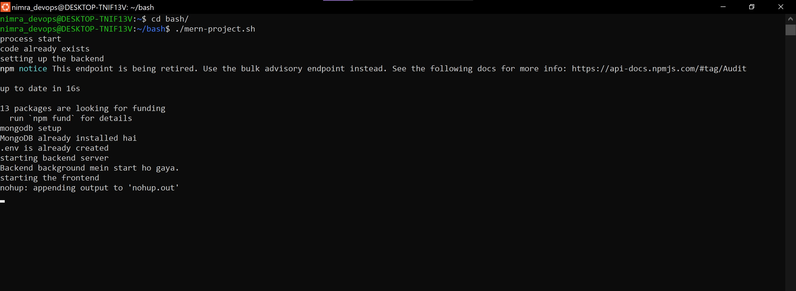
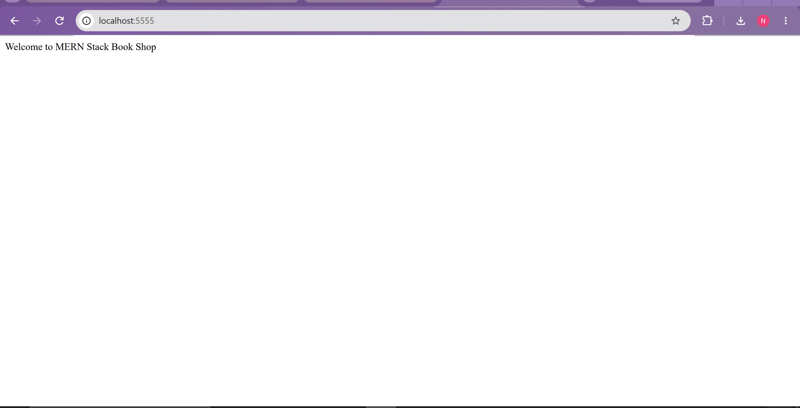
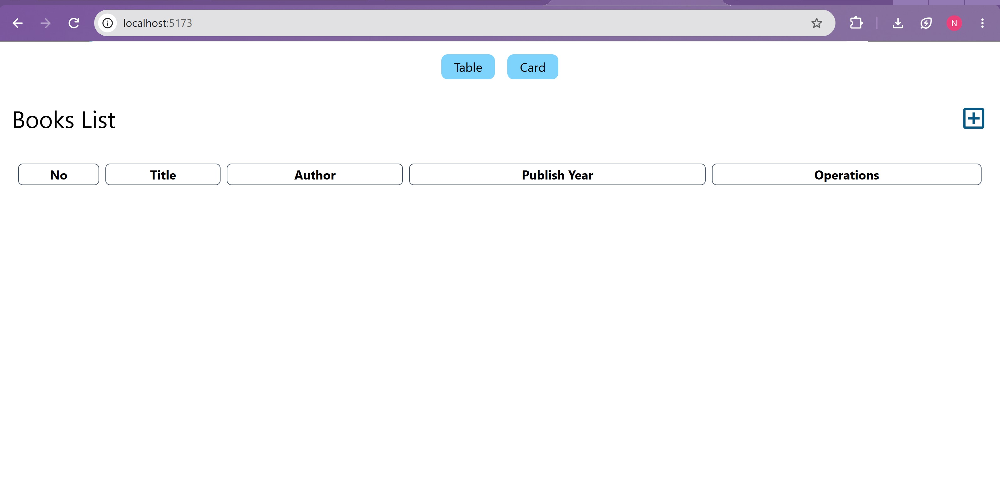
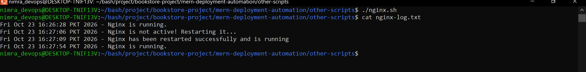
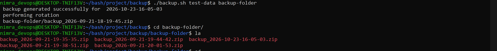

# MERN Deployment Automation with Bash & Nginx

A Bash automation script that clones, configures, and deploys a full-stack MERN application, paired with an Nginx reverse proxy setup that routes frontend and backend traffic through a single HTTPS entry point.

## What This Project Demonstrates

- Writing Bash scripts whose setup steps (clone, dependency install, MongoDB install, `.env` creation) are safe to re-run
- Automating a multi-service deployment: repository cloning, dependency installation, database setup, and process management
- Configuring Nginx as a reverse proxy for two independent services (frontend + backend) under one domain
- Using Nginx's `rewrite` directive to translate public-facing paths to internal API routes
- Debugging real deployment issues: outdated package names, service name mismatches, environment variable mismatches, and Nginx config conflicts

## Project Used for Testing

[Book-Store-Project](https://github.com/JosephDoUrden/Book-Store-Project) — a MERN stack app (React frontend, Express backend, MongoDB) — was used as a real-world target to automate and deploy, rather than testing against a trivial hello-world app.

## The Automation Script

The script (`mern-project.sh`) performs the following, each step gated by a check so the script can be re-run safely:

```bash
code_clone()        # Clones the repo if not already present, then cd's into it
backend_setup()      # Installs backend dependencies
mongodb_setup()       # Checks if MongoDB is installed; installs mongodb-org via the
                       # official MongoDB apt repository if missing, starts the service,
                       # and writes the .env file with the correct variable name
                       # (confirmed by reading config.js, not assumed from the README)
start_backend()        # Starts the backend with `nohup npm run dev &` so it survives
                        # after the script exits
frontend_setup()        # Installs frontend dependencies and starts the dev server,
                         # also backgrounded with nohup
```

### Key Bash concepts applied
- `command -v` to check whether a program (e.g. `mongod`) is installed
- `[ -f ]` / `[ -d ]` to check for files and directories before acting
- `||` for inline error handling (e.g. `cd backend || { echo "error"; exit 1; }`)
- `nohup ... &` to background long-running dev servers so the script can continue and exit cleanly
- Functions called explicitly at the bottom of the script — defining a function does not run it

## Nginx Configuration

```nginx
server {
    listen 443 ssl;
    server_name localhost;
    ssl_certificate /etc/nginx/ssl/self.cert;
    ssl_certificate_key /etc/nginx/ssl/self.key;

    location / {
        proxy_pass http://localhost:5173;   # React frontend (Vite dev server)
    }

    location /api {
        rewrite ^/api(/.*)$ $1 break;       # strips /api before forwarding
        proxy_pass http://localhost:5555;   # Express backend
    }
}

server {
    listen 80 default_server;
    listen [::]:80 default_server;
    server_name _;
    return 301 https://$host$request_uri;   # forces HTTPS
}
```

**Why the rewrite matters:** the frontend calls `/api/books`, but the Express backend only defines the route as `/books`. Without the rewrite, Nginx forwards `/api/books` as-is and the backend returns a 404. The rewrite strips the `/api` prefix before proxying, so the backend receives the path it actually expects.

## Verification

```bash
curl -k https://localhost/            # → frontend HTML
curl -k https://localhost/api/books   # → {"data":[]}  (backend + MongoDB response)
curl -I http://localhost              # → 301 redirect to https
```

## Issues Debugged Along the Way

- **MongoDB package name**: `mongodb` is no longer available in Ubuntu's default repos on newer releases — had to add the official `mongodb-org` apt repository instead.
- **Service name mismatch**: the installed service is `mongod`, not `mongodb`.
- **Environment variable mismatch**: the README documented `MONGODB_URI`, but the actual code (`config.js`) read `process.env.mongoDBURL` — traced this by reading the source rather than trusting the docs.
- **Nginx not picking up changes**: `sites-enabled` had a stale symlink pointing to an old config file from a previous project, so edits to `sites-available/default` were being silently ignored until the correct symlink was restored.
- **Background processes blocking the script**: `npm run dev` runs indefinitely in the foreground, which would have stalled the script at the backend step — solved with `nohup ... &`.

## Other Scripts

- `other-scripts/nginx.sh`: checks whether Nginx is running, restarts it if it is down, and logs each check with a timestamp.
- `other-scripts/<backup-script-name>.sh`: creates a timestamped zip backup of a folder and keeps only the 5 most recent backups (rotation using Bash array slicing).

## Screenshots

**Full script run**


**Backend and frontend running**



**Nginx health-check: detects a stopped service, restarts it, logs it**


**Backup rotation keeping the latest 5**

